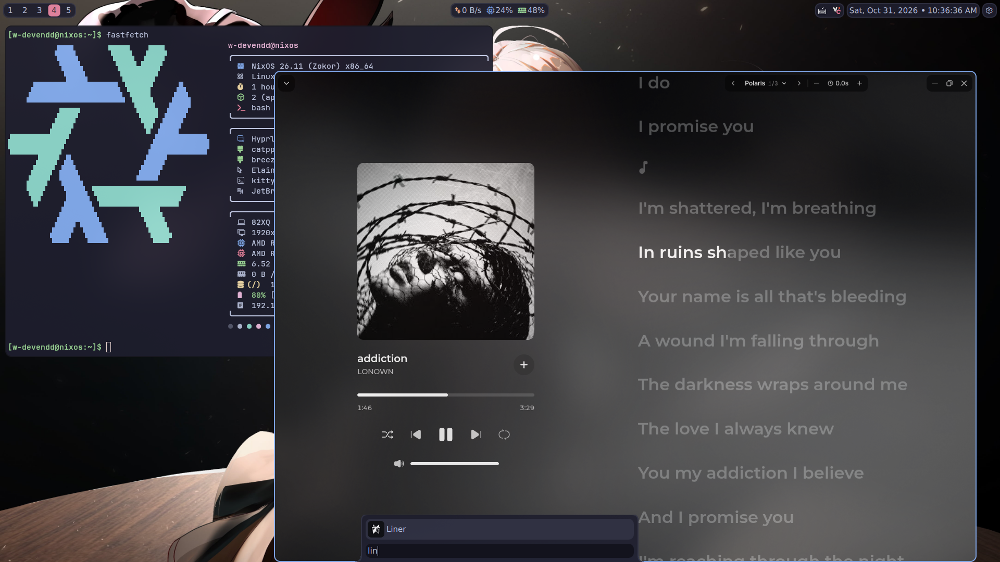

# Liner Flake ❄️

A Nix Flake to package the [**Liner Desktop**](https://tryliner.fun/) application (Liner Music Player) for NixOS.


## Supported
* x86_64-linux
* aarch64-linux

## Usage

### Run Instantly (Without Installing)
```bash
nix run github:W-DevEndd/liner-flake
```

### Add to NixOS Configuration
Add this flake to your `flake.nix`:
```nix
{
  inputs = {
    liner.url = "github:W-DevEndd/liner-flake";

    liner.inputs.nixpkgs.follows = "nixpkgs";
    # Or if you use nixpkgs-unstable:
    # liner.inputs.nixpkgs.follows = "nixpkgs-unstable";
  };

  # ...

  outputs = {
    nixpkgs,
    # some anether arg...
    liner,
    ...
  } @inputs: { # @inputs is VERY IMPORTANT
    nixosConfigurations."YOUR-HOSTNAME" = nixpkgs.lib.nixosSystem {
      specialArgs = { inherit inputs; }; # THIS IS VERY IMPORTANT
      modules = [
        ./configuration.nix
        # another configurations...

        # If you use home-manager
        { home-manager = {
          # ...

          extraSpecialArgs = { inherit inputs; };

          # ...
        }; }
      ];
    };
  };
}
```

Then add the package to your `environment.systemPackages` (etc: `configuration.nix`):
```nix
{ inputs, pkgs, config, lib,... }:
{
  # ...

  environment.systemPackages = [
    inputs.liner.packages.${liner.packages.${pkgs.stdenv.hostPlatform.system}.default
  ];
}
```

or with home-namager:
```nix
{ inputs, pkgs, config, lib,... }:
{
  # ...

  home.packages = [
    inputs.liner.packages.${liner.packages.${pkgs.stdenv.hostPlatform.system}.default
  ];
}
```

## Special Thanks
- [me](https:github.com/W-DevEndd) — Maintain this repo.
- [@tryliner](https://github.com/tryliner) — The upstream project.
- [Google AI Search](https:google.com) — Unlimit vibecoding:)

## License
[MIT LICENSE](./LICENSE)
